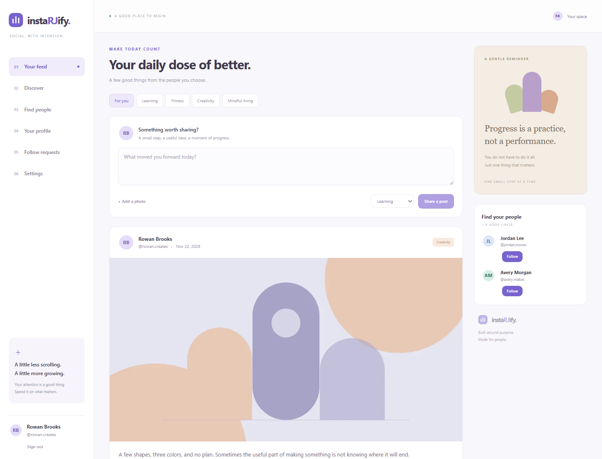

# instaRJify

**A little less scrolling. A little more growing.**

A purpose-focused social platform for learning, fitness, creativity, and mindful living. Choose a topic, share a small moment of progress, and build a circle on your own terms.



## The project

This project grew out of a college application I built to learn full-stack development. That original was an important part of learning how React, Express, and a relational database fit together. It is preserved separately.

This version keeps the original product idea, JavaScript stack, and core workflows, while making the engineering decisions explicit and testable. It is a modular monolith, not a collection of services added for appearance.

**Stack:** JavaScript, React, Vite, Express, MySQL 8.4, Node.js 24+, and Playwright.

## What works

- Register and sign in with a password; sessions survive an application restart and can be revoked on sign-out.
- Publish text or image posts, edit your own posts, and delete them. Post creation supports retry keys without producing duplicates.
- Browse following and discovery feeds, filter by purpose, and load older posts with stable keyset pagination.
- Follow public profiles immediately, request access to private profiles, accept or decline requests, cancel requests, unfollow, and remove followers.
- Find people by handle prefix and discover second-degree connections ranked by mutual connections.
- Update your profile, upload an avatar, change account privacy, and permanently delete your account with password confirmation.

There are no placeholder like/comment controls, simulated OAuth buttons, infinite-scroll engagement loops, or claimed AI recommendations.

## Run locally

You need **Node.js 24+** and **Docker with Docker Compose**. Run from the repository root:

```powershell
npm ci
npm run setup
docker compose up -d mysql --wait
npm run db:migrate
npm run db:seed
npm run dev
```

Open `http://localhost:5173`. The API listens on `http://127.0.0.1:3000`; Vite proxies `/api` requests. Use the `localhost` browser URL because it matches the generated `APP_ORIGIN`.

`npm run setup` generates an ignored `.env` with random development credentials and never overwrites an existing file. The seed contains fictional people and original procedural illustrations, not imported personal data. Sign in as `avery@example.test`, `jordan@example.test`, `rowan@example.test`, or `sam@example.test`, using `DEMO_PASSWORD` from your local `.env`. Sam has a private profile.

Already have MySQL? Create separate `instarjify` and `instarjify_test` databases, grant a local application user access, and set `DATABASE_URL` and `TEST_DATABASE_URL` in `.env`. The application does not connect to, or import data from, the original project's database.

### Run the containerized app

```powershell
npm run setup
docker compose up --build --wait
```

Open `http://localhost:3000`. This serves the built React application and API from one origin. Compose overrides the development origin appropriately. To add the synthetic demo data, run `npm run db:seed` on the host after `npm ci`; production containers deliberately refuse demo seeding.

Compose binds its published ports to localhost. For an actual deployment, configure `PUBLIC_ORIGIN` as your HTTPS origin, use a secret manager, and terminate TLS at your ingress. Secure cookies are derived from that HTTPS origin; HTTP is accepted in production mode only for a local demo.

## Engineering decisions

| Concern           | Implementation and reason                                                                                                                                                                                                           |
| ----------------- | ----------------------------------------------------------------------------------------------------------------------------------------------------------------------------------------------------------------------------------- |
| Clear boundaries  | Controllers own HTTP; services own rules and transaction boundaries; repositories own SQL and explicit DTOs. Dependencies are injected through `createApp`.                                                                         |
| Authentication    | Salted `scrypt` password hashes; random opaque session tokens stored only as SHA-256 hashes in MySQL; HttpOnly, SameSite=Strict cookies. Login replaces the current browser session.                                                |
| Authorization     | The authenticated session supplies the actor ID. Clients cannot assign post ownership or mutate somebody else's profile. Visibility is rechecked in content/media queries.                                                          |
| Privacy           | Private posts and graph lists require accepted access; direct image URLs use the same policy. API and image responses are not publicly cached.                                                                                      |
| Graph consistency | One `follows` table, one unique directed edge, explicit `pending`/`accepted` states, foreign keys, and no self-follow constraint. Mutations lock participant rows in a consistent order.                                            |
| Retry safety      | `POST /posts` requires a UUID `Idempotency-Key`. The request hash, post, and optional image commit together. Different input with the same key conflicts; a deleted post leaves a tombstone rather than being recreated by a retry. |
| Feed reads        | Joined author data avoids per-post lookups. Composite indexes and a `(created_at, id)` cursor avoid offset drift. All list endpoints have enforced page-size caps.                                                                  |
| Uploads           | Authenticate before buffering; accept one image up to 5 MB; decode and verify its actual format, cap pixels, strip metadata, resize, and re-encode as WebP. Processed images are capped at 2 MB.                                    |
| Operations        | Validated environment configuration, versioned/checksummed migrations with a database advisory lock, request IDs, structured logs without request bodies or cookies, liveness/readiness endpoints, and graceful shutdown.           |
| Reproducibility   | One workspace lockfile without machine-specific registry addresses; non-root multi-stage container; CI runs lint, tests, browser journeys, dependency audit, and a Compose smoke test.                                              |

See [the API reference](docs/API.md) for routes, request examples, errors, and privacy transitions.

## Deliberate tradeoffs

**A small, coherent system before distributed machinery.** MySQL owns canonical state. The feed is fan-out-on-read; a constant number of SQL round trips does not mean constant database work. Large follow graphs need query-plan and workload measurements before choosing precomputed timelines or queues. No throughput or user-count claims are made here.

**Images live in separate MySQL blob tables.** That keeps image metadata, authorization, retries, and rollback consistent without a second storage system. Feed queries do not read image blobs. A process admits at most two multipart uploads at once, from buffering through transaction completion. For a media-heavy deployment, move bytes to private object storage with an explicit authorization and retention design.

**Rate limits are per application process.** Sessions and graph constraints are shared through MySQL, but the in-memory request limiter is not a distributed limiter. A multi-instance deployment needs a shared rate-limit store and an explicitly configured trusted proxy boundary.

**Retention is explicit rather than hidden.** Sessions expire after seven days; expired rows for a user are removed during a subsequent login. Operators should also schedule indexed deletion of expired sessions. Post retry records live until account deletion, including tombstones for deleted posts. An archival/retention policy is a future operational decision.

Email verification, password recovery, account moderation, distributed feed fan-out, and cloud deployment are outside this version's scope.

## Project layout

```text
Backend/
  controller/       HTTP input/output
  middleware/       authentication, Origin checks, validation, errors
  services/         business rules and transaction boundaries
  repositories/     parameterized SQL and response projections
  db/               connection pool and versioned migrations
  lib/              password hashing, cursors, and safe image processing
  scripts/          migrations and local demo seed
  test/             unit, API, failure-injection, and concurrency tests
Frontend/my_app/
  src/Components/   React views and shared UI primitives
e2e/                complete browser journeys
docker/             local database initialization
```

## Verification

```powershell
npm run check
npx playwright install chromium
npm run test:e2e
npm audit --omit=dev
```

Integration and browser tests require `TEST_DATABASE_URL` to name a separate MySQL database ending in `_test`. Integration setup refuses to use the application database, then removes test fixtures inside the dedicated test database. Do not run these suites concurrently against the same test database.

GitHub Actions repeats the checks on Linux and starts the complete containerized application. The local revision diagrams and method-by-method learning guide are intentionally kept outside this published repository.

### Requirements check

| Requirement                                   | Executable evidence                                                                                                                                          |
| --------------------------------------------- | ------------------------------------------------------------------------------------------------------------------------------------------------------------ |
| Authentication, expiry, logout, and ownership | `Backend/test/integration/api.test.js`: cookie rotation, expiry, credential errors, owner-only mutations, and account deletion                               |
| Enforced private content and follow workflow  | API tests for direct posts/images, access revocation, requests, acceptance, and privacy transitions; two-browser-session journey                             |
| Consistency under retries and concurrency     | Two independent Node worker processes racing the same post key; duplicate/reciprocal follows; repeated accepts; injected image-write failure and clean retry |
| Bounded, stable reads                         | Equal-timestamp/new-insertion pagination tests, page-size validation, and explicit feed/suggestions SQL-query-count checks                                   |
| Safe input and media boundaries               | Mass-assignment, SQL-metacharacter, malformed JSON, body/file size, decoded-image, Origin, and rate-limit tests                                              |
| Working full-stack app                        | Desktop registration-to-edit-to-login journey, private-follow journey, narrow-viewport check, production build, and container readiness smoke test           |
